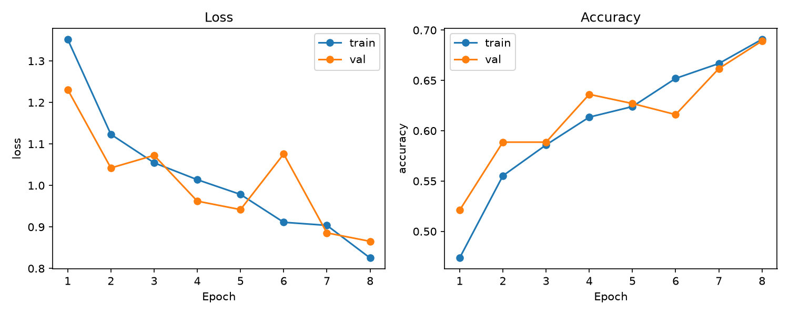
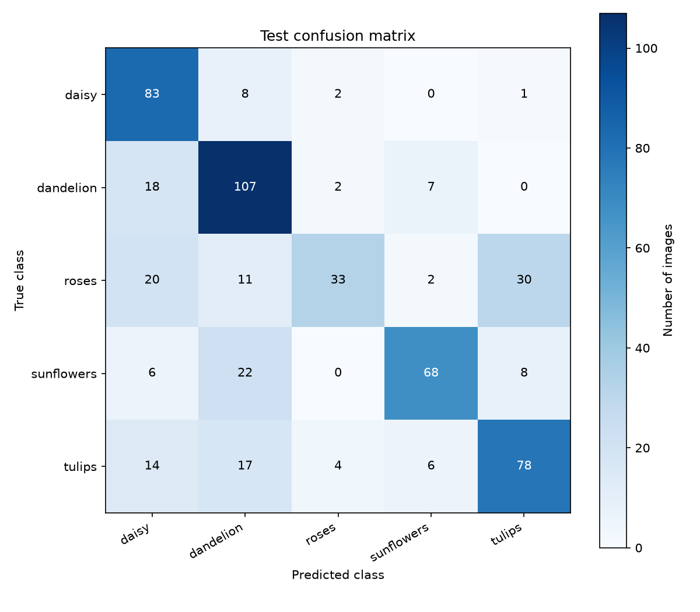

# 五类花卉分类实验：8 轮全量训练

本实验用手写 ResNet-18 从随机参数开始训练，使用全部 2572 张训练图片。
预先设定训练 8 轮，以验证准确率选择模型，再对保留的 547 张测试图片进行一次最终评估。
最佳模型来自第 8 轮，验证准确率为 68.92%，
测试准确率为 67.46%，宏平均 F1 为 0.6584。

## 数据与环境

原始 flower_photos 有 3670 张图片。清洗排除 2 张标签冲突图片，并移除 2 张同标签重复图片，保留 3666 张。
按类别划分约 70% 训练、15% 验证、15% 测试，随机种子为 42。

| 类别 | 训练 | 验证 | 测试 |
|---|---:|---:|---:|
| 雏菊 | 445 | 94 | 94 |
| 蒲公英 | 630 | 134 | 134 |
| 玫瑰 | 448 | 96 | 96 |
| 向日葵 | 489 | 104 | 104 |
| 郁金香 | 560 | 119 | 119 |
| 合计 | 2572 | 547 | 547 |

运行环境为 Windows、Python 3.12.14、PyTorch 2.14.1，
使用 CPU 和 4 个计算线程。依赖完整版本、归一化参数和文件哈希见
[provenance.json](../results/experiment-01/provenance.json)。训练代码版本为 `11904fb9c89a8943ab107d503404cc8c86e6753d`。

## 训练设置

| 设置 | 值 |
|---|---|
| 网络 | 手写 ResNet-18，11,179,077 个参数，无预训练权重 |
| 输入 | RGB，96×96 |
| 归一化 | 仅用训练集计算 mean/std，统计尺寸为 32×32 |
| 数据增强 | 训练时随机水平翻转 |
| Batch size | 16，末批 12 张，本实验未舍弃图片 |
| 优化器 | Adam |
| 学习率 / 权重衰减 | 0.001 / 0.0001 |
| 损失 | 交叉熵 |
| 训练轮数 / 随机种子 | 8 / 42 |
| 模型选择 | 验证准确率最高，相同时保留较早轮次 |

每轮完整处理 2572 张训练图片和 547 张验证图片。
8 轮训练及验证的计时合计 293.0 秒（约 4.9 分钟），
不包括初始化、保存权重、绘图和最终测试。配置原文件见 [config.json](../results/experiment-01/config.json)。

## 每轮记录

| 轮次 | 训练 loss | 训练准确率 | 验证 loss | 验证准确率 | 耗时（秒） |
|---:|---:|---:|---:|---:|---:|
| 1 | 1.3522 | 47.36% | 1.2311 | 52.10% | 36.8 |
| 2 | 1.1232 | 55.52% | 1.0422 | 58.87% | 37.2 |
| 3 | 1.0546 | 58.59% | 1.0726 | 58.87% | 37.0 |
| 4 | 1.0139 | 61.35% | 0.9622 | 63.62% | 37.0 |
| 5 | 0.9784 | 62.40% | 0.9419 | 62.71% | 36.4 |
| 6 | 0.9112 | 65.20% | 1.0759 | 61.61% | 37.2 |
| 7 | 0.9038 | 66.68% | 0.8857 | 66.18% | 35.9 |
| 8 | 0.8252 | 69.09% | 0.8654 | 68.92% | 35.5 |



图中 train 表示训练集，val 表示验证集。横轴是训练轮次，loss 越低通常越好，accuracy 越高越好。
训练指标是在一轮内边更新参数边累计，验证指标是在该轮更新结束后使用 `eval()` 计算；
两者的增强与 BatchNorm 行为也不同，因此不能把每一轮的差值全部解释成过拟合。
完整精度记录见 [history.csv](../results/experiment-01/history.csv)。

## 测试结果

加载第 8 轮权重，完整预测 547 张测试图片，其中 369 张正确、178 张错误。
测试准确率为 **67.46%**，宏平均 F1 为 **0.6584**。

| 类别 | 测试数量 | 精确率 | 召回率 | F1 |
|---|---:|---:|---:|---:|
| 雏菊（daisy） | 94 | 58.87% | 88.30% | 0.7064 |
| 蒲公英（dandelion） | 134 | 64.85% | 79.85% | 0.7157 |
| 玫瑰（roses） | 96 | 80.49% | 34.38% | 0.4818 |
| 向日葵（sunflowers） | 104 | 81.93% | 65.38% | 0.7273 |
| 郁金香（tulips） | 119 | 66.67% | 65.55% | 0.6610 |

玫瑰的精确率较高，但召回率低：模型预测为玫瑰的 41 张中有 33 张正确，
实际 96 张玫瑰中却只认对 33 张。这说明它漏掉了不少玫瑰，不能仅看精确率评价效果。



行是真实类别，列是预测类别。对角线记录正确预测数量。数量最多的三种有方向的混淆为：

- 玫瑰被预测为郁金香：30 张。
- 向日葵被预测为蒲公英：22 张。
- 玫瑰被预测为雏菊：20 张。

这些数量描述当前测试结果，单凭矩阵无法确定错误来自背景、花瓣外观还是图片质量。
逐图预测见 [predictions.csv](../results/experiment-01/predictions.csv)，
错误路径见 [misclassified.csv](../results/experiment-01/misclassified.csv)。

## 单图预测示例

使用测试集中的 `daisy/100080576_f52e8ee070_n.jpg`，真实类别为雏菊，输出前三个候选：

| 排名 | 类别 | softmax 分数 |
|---:|---|---:|
| 1 | 雏菊 | 45.83% |
| 2 | 蒲公英 | 35.20% |
| 3 | 向日葵 | 11.90% |

这是数据集内示例，不代表对新拍摄图片的验证。分数未经概率校准。
原始输出见 [example-prediction.json](../results/experiment-01/example-prediction.json)。

## 复现实验

按 README 安装依赖、下载数据并运行 `src.prepare` 后，从仓库根目录执行：

```powershell
.\.venv\Scripts\python.exe -m src.train --epochs 8 --image-size 96 --batch-size 16 --learning-rate 0.001 --seed 42 --num-threads 4 --device cpu --output runs/experiment-02
.\.venv\Scripts\python.exe -m src.evaluate --checkpoint runs/experiment-02/best.pt --device cpu
.\.venv\Scripts\python.exe -m src.predict --checkpoint runs/experiment-02/best.pt --image data/flower_photos/daisy/100080576_f52e8ee070_n.jpg --device cpu
```

每次训练使用新目录，已有 `runs/experiment-02` 时请换名。
本次本地权重位于 `runs/experiment-01/best.pt`；仓库收录配置、划分清单、指标、图表和预测记录，
权重与原始图片保存在本地。从新克隆的仓库运行预测前，需要先训练生成自己的权重。
不同硬件和软件版本下的数值可能略有差异。

训练时的 [manifest.csv](../results/experiment-01/manifest.csv) 保存了图片路径、内容哈希和集合归属。
其原始字节 SHA-256 为 `bd7affb54c4b5b720996bf0b61f66503a2d668e7a5cc935d4eb603e09814a5aa`。核对划分时应保留文件编码和换行。
均值和标准差仅来自训练集；测试集不用于梯度更新、最佳模型选择或反复调参。

## 局限与后续实验

本结果来自单个划分和单个随机种子，不能代表所有拍摄条件下的准确率。
96×96 输入可能丢失花瓣细节；完全重复检查也无法排除裁剪、压缩后的相似图片。
模型只输出五个已知类别，尚未验证未知花种、非花卉图片或真实拍摄场景。

后续可基于验证集比较更高输入分辨率、适度的数据增强或学习率调度，并记录额外耗时与验证表现。
本次测试结果已用于报告；若持续改进并查看这些错误，应另外保留新的独立数据做最终检验。
